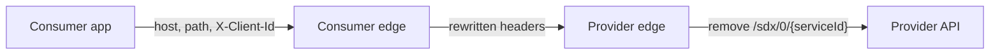

Peer-to-peer SDX selects a connection on the consumer edge, rewrites a small
set of headers, and selects the same connection again on the provider edge.
This page records that contract for `sdx-p2p-consumer.r1` and
`sdx-p2p-provider.r1`, which headers a provider may trust, and the
backward-compatible `r2` patterns that move consumer selection off
`X-Client-Id`.

`X-Client-Id` and `X-Service-Id` are live route selectors. Renaming or
removing them requires a new pattern version so existing callers keep
working. This page is also the consumer request interface for a shared Edge
Runtime and a dedicated Edge Runtime.

Message fields that are not route keys stay in the
[SDX Data Access Protocol](/reference/sdx/data-access-protocol.md). Connection
parameters stay in
[Connection Resources](/how-to/sdx-connection-resources.md).

!!! warning "r2 is the contract for a later change"
    `sdx-p2p-consumer.r1` and `sdx-p2p-provider.r1` are the live patterns.
    Existing `SDX.R0.00` and `SDX.R1.00` connections keep those patterns.
    The `r2` sections below apply only after a connection moves to the `r2`
    pattern ids.

## Request path

The calling application uses the consumer runtime host and
`/sdx/0/{serviceId}/...`, with `X-Client-Id` set to the subsystem id. The
consumer edge rewrites the managed headers and forwards the request to the
service runtime `sdxEndpoint`. The provider edge removes `/sdx/0/{serviceId}`
and calls the provider API. Applications call the consumer edge.

## Current route selection

`{serviceId}` is the catalog service `name`, the same value as the connection
`serviceId`. The edge token records it in the `service_id` claim. It is the
service name, not the service title. The path prefix is `/sdx/0/{serviceId}`.
The main route on each edge allows only `DELETE`, `GET`, `POST`, and `PUT`.
The provider `/hello` route allows only `GET`.

### Consumer edge

The consumer route matches all of the following:

- The route host is that runtime's `consumerEndpoint`. When
  `clientRuntimeOverride` is set, the host is the override runtime's
  endpoint.
- The path is `/sdx/0/{serviceId}`.
- The header `X-Client-Id` equals the connection subsystem id.

The service id is in the path. The subsystem id is the header. Callers may
omit `X-Service-Id`. The consumer edge sets it from the connection for the
provider route.

After that match, SDX removes caller-supplied `X-Client-Id`,
`X-SDX-Client-Subsystem-Id`, and `X-Service-Id`, then sets each one from the
provisioned connection. SDX also replaces `Host` with the service runtime
host. A wrong `X-Client-Id` selects a different connection or no route. SDX
overwrites the other two headers from the connection that matched.

With the default `stripPath` value, `false`, `/sdx/0/{serviceId}` is still on
the request when it reaches the provider edge. `stripPath: true` removes that
prefix before the provider route, so the provider route does not match.

### Inter-edge request

The consumer edge forwards the request to the service runtime `sdxEndpoint`.
SDX adds `X-Edge-Token` when the connection includes the `sign` upgrade.
`SDX.R0.00` and `SDX.R1.00` defaults include that upgrade.

When the connection includes `tokenExchange`, SDX sets `X-SDX-Original-AZP`
from the `azp` of the token it has already verified, and removes a
caller-supplied value. SDX omits the header when that `azp` is missing or
empty. Trust this header when that connection performs token exchange. A
connection without `tokenExchange` can still forward a caller-supplied value.
`SDX.R0.00` defaults omit `tokenExchange`.

### Provider edge

The provider route matches all of the following:

- the service runtime host
- the same `/sdx/0/{serviceId}` path
- both `X-Client-Id` and `X-Service-Id`

The provider edge removes `/sdx/0/{serviceId}`, so the provider API sees its
own path. It does not rewrite `X-Client-Id`, `X-Service-Id`, or
`X-SDX-Client-Subsystem-Id`. It accepts the values the consumer edge wrote.
A `GET` to `/sdx/0/{serviceId}/hello`, with the same two headers, is answered
by the provider edge and is not forwarded to the provider API.

`SDX.R0.00` and `SDX.R1.00` defaults include `mtlsAuth`, `mtlsAcl`, and
edge-token `verify`. `mtlsAcl` compares the client certificate CN with the
client runtime `host`. That value is the runtime `host`, not the runtime
group `name`. When `clientRuntimeOverride` is set, the allow list uses the
override runtime's `host`. `SDX.R1.00` requires the provider `token` upgrade.
It does not require `mtlsAuth`, `mtlsAcl`, or `verify`. A provider can treat
these identity headers as written by SDX when those inter-edge checks
accepted the request.

### Authorization and route selection

Matching a route does not prove the caller is that subsystem. The binding
check runs on the consumer edge.

On `SDX.R1.00`, the consumer edge checks the original token, before token
exchange. The `token` upgrade sets `consumerMatch` on `azp` with
`consumerMatchClaimCustomId`, so `azp` must equal the integration client's
`custom_id`. The `acl` upgrade allows the subsystem id of the route that
matched. `X-Client-Id` chooses the subsystem. A token is rejected when that
integration client is not allowed for the selected subsystem.

The provider `token` upgrade on `SDX.R1.00` sets `consumerMatch` to false. It
checks the token issuer and audience. `SDX.R1.00` does not install
`tokenExchange` on the provider edge. After exchange, the provider sees the
SDX exchange client's token. The original client id is `X-SDX-Original-AZP`.

`SDX.R0.00` defaults do not install `token`, `acl`, or `tokenExchange`. On
those connections the consumer header match is the selection, unless those
upgrades are added.

## Header trust

`Content-Digest` and `Correlation-Id` are defined in the
[SDX Data Access Protocol](/reference/sdx/data-access-protocol.md). They are
message fields.

| Value | Supplied by | Replaced by | Who may trust it |
| ----- | ----------- | ----------- | ---------------- |
| Request path `/sdx/0/{serviceId}` | Calling application | Consumer edge leaves the prefix in place when `stripPath` is false. Provider edge removes it before the API. | Both edges, as the service route key. The provider API sees its own path. |
| Host | Calling application, as the consumer runtime host | Consumer edge sets `Host` to the service runtime host. The request goes to `sdxEndpoint`. | Provider edge, as its own runtime host. The host is not the client subsystem. |
| `X-Client-Id` | Calling application. The consumer route requires the connection subsystem id. | Consumer edge removes the caller value and sets the provisioned subsystem id. The provider edge does not rewrite it. | Consumer edge, as the r1 route selector. Provider edge, together with `X-Service-Id`. Existing provider integrations may read the rewritten value. New integrations use `X-SDX-Client-Subsystem-Id`. |
| `X-Service-Id` | Calling application may send it. The consumer route selects the service from the path. | Consumer edge removes the caller value and sets the provisioned service id. The provider edge does not rewrite it. | Provider edge, together with `X-Client-Id`. The value was set from the connection. |
| `X-SDX-Client-Subsystem-Id` | SDX, from the connection subsystem id. It is not a route key today. | Consumer edge removes a caller value, then sets the provisioned subsystem id. The provider edge does not rewrite it. | Provider API, for new integrations, when the inter-edge checks accepted the request. The prefix marks SDX as the source. |
| `X-SDX-Original-AZP` | SDX, from the verified `azp`, when `tokenExchange` is enabled. | SDX removes a caller value first, then sets the verified `azp` or omits the header. A connection without token exchange can still forward a caller value. | Provider API, when that connection performs token exchange. One client id, not an exchange history. After exchange, this is the original client id. The provider token's `azp` is the SDX exchange client. |
| `X-Edge-Token` | SDX, on the request from the consumer edge and on the response from the provider edge, when `sign` is enabled. | The sending edge replaces a caller-supplied value. | The receiving edge, after it verifies the signature. |
| `Authorization` | Calling application, as the client identity JWT. | SDX replaces it when `tokenExchange` is enabled. The replacement token's `azp` is the SDX exchange client. Otherwise the original token is forwarded. | The consumer edge, before exchange, for the `azp` and subsystem checks. The provider API still validates the token it receives. It is not a route key. |

## Managed-header names

Values SDX constructs, and that a provider is told to trust, use the `X-SDX-`
prefix. `X-SDX-Client-Subsystem-Id` and `X-SDX-Original-AZP` already follow
that rule.

`X-Service-Id` becomes `X-SDX-Service-Id` when provider route matching changes.
`X-Client-Id` keeps its name. It remains the r1 selector and the compatibility
copy of the subsystem id. New integrations use `X-SDX-Client-Subsystem-Id`.
Callers stop sending `X-Client-Id` when they call an r2 route. SDX stops
sending `X-Client-Id` to providers only in a later pattern, after those
providers no longer require it.

`X-Edge-Token` keeps its name through the routing change. Both edges, and the
provider response signature, already use that name. The response signature
reads the inbound token from the header `X-Edge-Token`. A later, separate
change may rename it to `X-SDX-Edge-Token`. That change accepts both names
before the current name is removed.

## Consumer request interface

### Shared Edge Runtime

A shared Edge Runtime hosts many subsystems on one public host. PZGW is that
shape: one `consumerEndpoint` for member organizations that do not run their
own edge. See
[The public consumer host (PZGW)](/concepts/secure-data-exchange.md).

The later shared pattern selects the subsystem in the path. The path version
stays `0`:

`/sdx/0/{clientSubsystemId}/{serviceId}/...`

The application stops sending `X-Client-Id`. The hostname stays the shared
public host, so it cannot select the subsystem. Caller-supplied
`X-Client-Id`, `X-Service-Id`, `X-SDX-Client-Subsystem-Id`, and
`X-SDX-Service-Id` are discarded. The path selects the connection, and SDX
writes those headers from that connection.

The provider still receives `/sdx/0/{serviceId}/...`. The consumer edge
removes `{clientSubsystemId}` and leaves the service segment. Removing the
whole `/sdx/0/{clientSubsystemId}/{serviceId}` prefix would also drop
`{serviceId}`, and the provider route would not match. Many clients share one
service host, so the provider continues to select the client from the headers
the consumer edge set.

An r1 route whose service name equals `{clientSubsystemId}` uses the prefix
`/sdx/0/{clientSubsystemId}`. The shared r2 path is the route that serves
`/sdx/0/{clientSubsystemId}/{serviceId}/...`. That r1 prefix must not capture
the shared path.

### Dedicated Edge Runtime

A dedicated Edge Runtime is bound to one consumer subsystem. The caller path
stays `/sdx/0/{serviceId}/...`. The subsystem id comes from deployment
configuration. The application does not send `X-Client-Id` on the r2 route.
Caller-supplied identity headers are discarded, and SDX writes them from the
bound connection.

During the compatibility window the legacy route and the r2 route share the
host and `/sdx/0/{serviceId}`:

- `X-Client-Id` present and equal to the bound subsystem: the legacy route
  matches that connection.
- `X-Client-Id` absent: the legacy route does not match. The r2 route matches,
  and the subsystem comes from the deployment binding.
- `X-Client-Id` present and different: the legacy route does not match. The
  r2 route matches, SDX discards the supplied header, and the subsystem still
  comes from the deployment binding.

A runtime group cannot supply that single subsystem id today. Until that
binding exists, callers use the current header route.

### Provider selection

Provider selection stays on headers. The future provider route matches
`X-SDX-Client-Subsystem-Id` and `X-SDX-Service-Id`, which the consumer edge
sets. Applications call the consumer edge. The provider still receives
`/sdx/0/{serviceId}/...`.

## Migration to r2

Pattern ids carry this contract version. The path version stays `0`. New
pattern ids are `sdx-p2p-consumer.r2` and `sdx-p2p-provider.r2`.
`SDX.R0.00` and `SDX.R1.00` stay on `sdx-p2p-consumer.r1` and
`sdx-p2p-provider.r1`. A connection adopts `r2` by a later policy version or
by an explicit opt-in to those pattern ids. The compatibility window below
applies to connections that have moved to `r2`.

During that window, callers can use either shape:

1. The current route: consumer host, `/sdx/0/{serviceId}`, and `X-Client-Id`.
1. The new route for that runtime. A shared runtime uses
   `/sdx/0/{clientSubsystemId}/{serviceId}/...`. A dedicated runtime uses
   `/sdx/0/{serviceId}/...` and takes the subsystem from deployment
   configuration. The new route does not use `X-Client-Id`.

On an r2 consumer route, SDX discards caller-supplied `X-Client-Id`,
`X-Service-Id`, `X-SDX-Client-Subsystem-Id`, and `X-SDX-Service-Id`, then
writes them from the matched connection.

SDX still sends `X-Client-Id`, `X-Service-Id`, `X-SDX-Client-Subsystem-Id`,
and `X-SDX-Service-Id`. An r1 provider matches only the old pair, so SDX keeps
sending that pair until every provider on the connection accepts the new pair.

A route requires every header listed on it, so the r2 provider publishes two
routes on the service host and `/sdx/0/{serviceId}`:

1. `X-Client-Id` and `X-Service-Id`
1. `X-SDX-Client-Subsystem-Id` and `X-SDX-Service-Id`

Both routes use the same upstream and plugins. Each pair has a `GET`
`/hello` route, answered by the provider edge and not forwarded to the
provider API. A request that carries both pairs matches both routes and has
that one outcome.

The consumer-edge authorization checks stay as they are. On `SDX.R1.00`,
verified `azp` must equal the integration client, and the consumer-edge ACL
must allow the subsystem the route selected.

After the window, a later pattern drops the current route and stops sending
`X-Client-Id` and `X-Service-Id`. The `X-Edge-Token` rename stays a separate
change.
