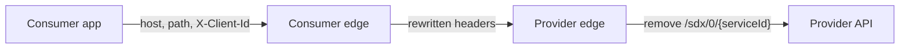

Peer-to-peer SDX selects a connection on the consumer edge, rewrites a small
set of headers, and selects the same connection again on the provider edge.
This page records that behavior for `sdx-p2p-consumer.r1` and
`sdx-p2p-provider.r1`.

`X-Client-Id` and `X-Service-Id` are live route selectors. Which values a
provider may trust is recorded in the
[SDX Data Access Protocol](/reference/sdx/data-access-protocol.md#header-trust).
Connection parameters stay in
[Connection Resources](/how-to/sdx-connection-resources.md).

## Request path

The calling application uses the consumer runtime host and
`/sdx/0/{serviceId}/...`, with `X-Client-Id` set to the subsystem id. The
consumer edge rewrites the managed headers and forwards the request to the
service runtime `sdxEndpoint`. The provider edge removes `/sdx/0/{serviceId}`
and calls the provider API. Applications call the consumer edge.

## Route selection

`{serviceId}` is the catalog service `name`, the same value as the connection
`serviceId`. The edge token records it in the `service_id` claim. It is the
service name, not the service title. The path prefix is `/sdx/0/{serviceId}`.
The main route on each edge allows only `DELETE`, `GET`, `POST`, and `PUT`.
The provider `/hello` route allows only `GET`.

### Consumer edge

The consumer route matches all of the following:

- The route host is that runtime's `consumerEndpoint`. When
  `clientRuntimeOverride` is set, the host is the override runtime's
  endpoint.
- The path is `/sdx/0/{serviceId}`.
- The header `X-Client-Id` equals the connection subsystem id.

The service id is in the path. The subsystem id is the header. Callers may
omit `X-Service-Id`. The consumer edge sets it from the connection for the
provider route.

After that match, SDX removes caller-supplied `X-Client-Id`,
`X-SDX-Client-Subsystem-Id`, and `X-Service-Id`, then sets each one from the
provisioned connection. SDX also replaces `Host` with the service runtime
host. A wrong `X-Client-Id` selects a different connection or no route. SDX
overwrites the other two headers from the connection that matched.

With the default `stripPath` value, `false`, `/sdx/0/{serviceId}` is still on
the request when it reaches the provider edge. `stripPath: true` removes that
prefix before the provider route, so the provider route does not match.

### Inter-edge request

The consumer edge forwards the request to the service runtime `sdxEndpoint`.
SDX adds `X-Edge-Token` when the connection includes the `sign` upgrade.
`SDX.R0.00` and `SDX.R1.00` defaults include that upgrade.

### Provider edge

The provider route matches all of the following:

- The route host is the service runtime host.
- The path is the same `/sdx/0/{serviceId}` prefix.
- The headers `X-Client-Id` and `X-Service-Id` are both present.

The provider edge removes `/sdx/0/{serviceId}`, so the provider API sees its
own path. `X-Client-Id` and `X-Service-Id` are internal routing headers. The
provider API uses `X-SDX-Client-Subsystem-Id` and must not depend on those
two headers. A `GET` to `/sdx/0/{serviceId}/hello`, with the same two
headers, is answered by the provider edge and is not forwarded to the
provider API.

### Authorization and route selection

Matching a route does not prove the caller is that subsystem. The binding
check runs on the consumer edge.

On `SDX.R1.00`, the consumer edge checks the original token, before token
exchange. The `token` upgrade sets `consumerMatch` on `azp` with
`consumerMatchClaimCustomId`, so `azp` must equal the integration client's
`custom_id`. The `acl` upgrade allows the subsystem id of the route that
matched. `X-Client-Id` chooses the subsystem. A token is rejected when that
integration client is not allowed for the selected subsystem.

The provider `token` upgrade on `SDX.R1.00` sets `consumerMatch` to false. It
checks the token issuer and audience. `SDX.R1.00` does not install
`tokenExchange` on the provider edge. After exchange, the provider sees the
SDX exchange client's token.

`SDX.R0.00` defaults do not install `token`, `acl`, or `tokenExchange`. On
those connections the consumer header match is the selection, unless those
upgrades are added.
